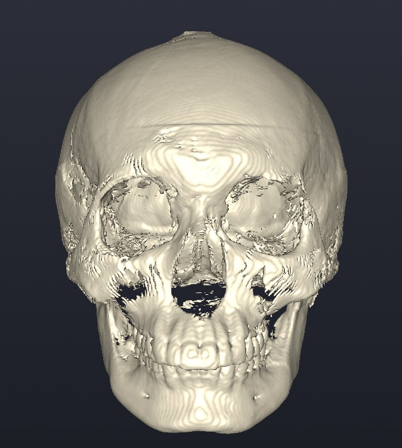
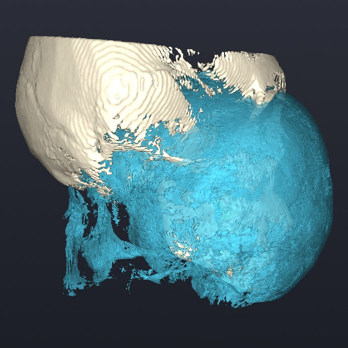
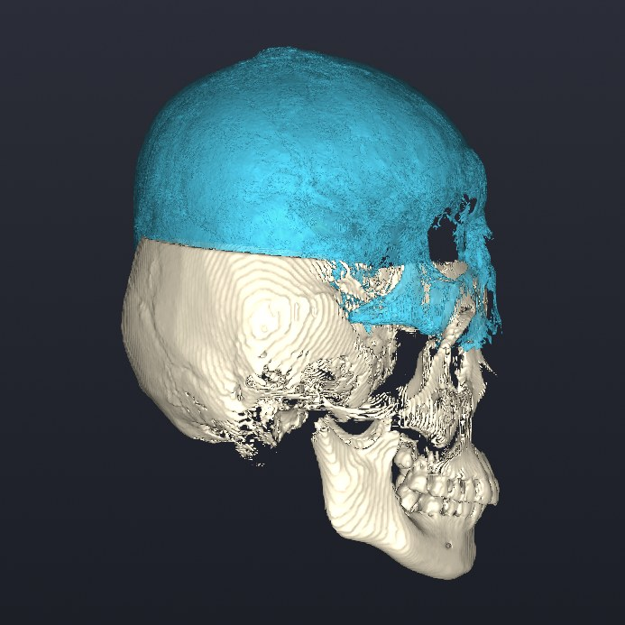
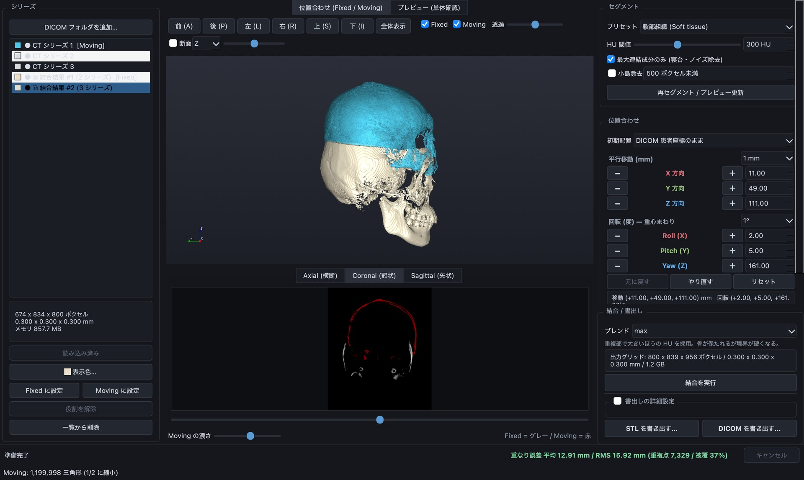

# head3Dv1 for macOS

**分けて撮った CT を手で位置合わせして 1 つにつなぎ、3D プリント用の STL や DICOM として書き出せる Mac アプリ。**
Python の環境構築は要らず、ダブルクリックで起動できます。

[](https://github.com/Jin-hiroo/dicom-merge-tool-mac/actions/workflows/build-macos.yml)
[](https://github.com/Jin-hiroo/dicom-merge-tool-mac/releases/latest)
[](#動作環境)
[](LICENSE)

[ダウンロード](https://github.com/Jin-hiroo/dicom-merge-tool-mac/releases/latest) ·
[使い方](#使い方) ·
[詳しい操作（元リポジトリ）](https://github.com/Jin-hiroo/dicom-merge-tool#使い方) ·
[自分でビルドする](#自分でビルドする) ·
[トラブルシューティング](#トラブルシューティング)

<p>
  <a href="docs/images/printed-skull.jpg"></a>
  <a href="docs/images/merged-skull-3d.jpg"></a>
</p>

_左: 頭部 CT の 3 シリーズをこのアプリで 1 つに結合し、書き出した STL を 3D プリントしたもの（黒い台座はアプリの出力ではありません）。
右: 同じ結合結果をアプリの 3D ビューで正面から見たところ。額を横切る線が、シリーズをつないだ継ぎ目です。_

<p>
  <a href="docs/images/align-before.jpg"></a>
  <a href="docs/images/align-after.jpg"></a>
</p>

_同じ CT を横から見た位置合わせの前後。ベージュが基準のシリーズ（Fixed。先に 2 本を結合したもの）、水色が動かすシリーズ（Moving。頭頂部）。
左: 読み込んだ直後。DICOM の座標のままでは向きも位置も合っていません。右: 移動と回転のボタンで合わせた後。_

> **本ソフトウェアは診断用医療機器ではありません。**
> 研究・造形補助を目的としたツールであり、臨床診断には使用しないでください。
> 患者データはすべてこの Mac 内でのみ処理され、外部送信は一切行いません。
> （アプリ版がネットワークに接続するのは、メニューから「アップデートを確認…」を選んだときに
> GitHub へ最新版を問い合わせる場合だけです。患者データやファイルの情報は送りません。）

このリポジトリは、[dicom-merge-tool](https://github.com/Jin-hiroo/dicom-merge-tool)（head3Dv1 — DICOM 結合支援ツール）を
ダブルクリックで起動できる macOS アプリ **`head3Dv1.app`** にするためのものです。
**元のリポジトリとコードには一切手を加えていません。** 元コードは `upstream/` に
git サブモジュールとして（コミットを固定して）読み込み、そのままアプリに同梱します。

## 特長

1 回で撮りきれずに複数のシリーズに分かれた CT は、そのままでは 1 つの模型にできません。
head3Dv1 では重なった部分を見ながら手で位置を合わせ、1 つのボリュームに結合してから書き出します。

- **何本でも順につなげる。** 2 本を結合すると結果が次の基準（Fixed）になり、3 本目以降も同じ手順で足していけます。
- **mm 単位で追い込める手動の位置合わせ。** 移動（X/Y/Z）と回転（Roll/Pitch/Yaw）のボタンや矢印キーで動かし、
  2D 断面の重ね合わせ（Fixed = グレー / Moving = 赤）と「重なり誤差」の数値で確かめます。
  ボタン操作ではメッシュを作り直さないので、すぐに反映され、Undo / Redo もできます。
- **3D プリント用の STL と、ビューアで開ける DICOM。** STL は書き出すときにフル解像度でメッシュ化します。
  DICOM は派生データ（`DERIVED / SECONDARY`）として新しいフォルダに書き出すので、3D Slicer や PACS ビューアで開けます。
  書き出して読み戻すと HU 値まで一致することを、元リポジトリのテストで確かめています。
- **16 GB の Mac で大きな CT を扱える。** ボリュームは `int16` の memmap に置いて RAM に全部は載せず、
  結合も Z 方向に分けて処理します。元リポジトリの実測では、Apple M2 / 16 GB で 512×512×600 を 2 本結合して 1.6 秒、
  STL 書き出し（200 万三角形）が 20.5 秒です。
- **重い処理の間も操作できる。** 読み込み・結合・書き出しは別スレッドで動き、進捗表示とキャンセルがあります。
- **作業が消えない。** 終了時に自動保存し、次に起動したときに復元できます。時間をかけた位置合わせと結合結果も戻ります。
- **普通の Mac アプリとして使える。** 13〜14 インチの画面にも収まり、作業データは iCloud で同期されない
  `~/Library/Application Support/head3Dv1/` に置きます。メニューからアップデートでき、ダウンロードは SHA-256 で照合します。

<a href="docs/images/app-window.jpg"></a>

_上と同じ位置合わせの途中のメインウィンドウ。左: シリーズ一覧（シリーズ名は伏せてあります）。
中央: 3D ビューと 2D 断面の重ね合わせ。右: HU 閾値、位置合わせ（移動・回転のボタンと数値）、結合と書き出し。_

## 動作環境

- Apple Silicon (M1 / M2 / M3 …) の Mac
- macOS 14 Sonoma 以降（GitHub Actions で作った DMG の場合。同梱の SciPy が macOS 14 向けのため）
  - 対応する最小 macOS は、同梱したライブラリが要求する版から自動で決まり、Info.plist に書き込まれます。
    macOS 13 以前の Mac で自分でビルドすると、その Mac 向けのライブラリが選ばれるため、その Mac で動きます
- メモリ 16 GB 以上を推奨（元ツールと同じ）

## インストール

[最新のリリース](https://github.com/Jin-hiroo/dicom-merge-tool-mac/releases/latest)から DMG を入れます。設定は要りません。

1. `head3Dv1-<バージョン>-arm64.dmg`（約 180 MB）をダウンロードして開く
   （GitHub の [Actions](../../actions) の成果物 `head3Dv1-arm64` でも入手できます。
   自分でビルドした場合は `dist/` にあります）
2. `head3Dv1` を `Applications` フォルダへドラッグ
3. Launchpad または `/Applications/head3Dv1.app` から起動

ソースからビルドする場合は（Python 3.12 が必要。詳しくは[自分でビルドする](#自分でビルドする)）:

```bash
git clone --recursive https://github.com/Jin-hiroo/dicom-merge-tool-mac.git
cd dicom-merge-tool-mac && ./build.sh
```

### 初回起動で「開けません」と出た場合

このアプリは Apple の Developer ID で署名・公証していない（アドホック署名のみ）ため、
**インターネットからダウンロードした DMG** から入れた場合は初回だけ macOS に止められます。
自分の Mac で `./build.sh` してできたアプリではこの操作は不要です。

- **システム設定 → プライバシーとセキュリティ** を開き、下の方の
  「"head3Dv1" は開発元を確認できないため…」の横の **［このまま開く］** を押す
- それでも「壊れているため開けません」と出る場合はターミナルで:

  ```bash
  xattr -dr com.apple.quarantine /Applications/head3Dv1.app
  ```

DICOM をデスクトップ・書類・USB / CD などから読むときに、macOS がフォルダへの
アクセス許可を求めることがあります。［許可］してください。

## 使い方

重なりのある CT シリーズを 2 本以上用意して、次の順に操作します。

1. **DICOM フォルダを追加…** でフォルダを選ぶ（中を走査して CT シリーズを見つけます）
2. 1 本目を選んで **読み込む**（自動で Fixed になります）。2 本目も読み込んで **Moving に設定**
3. 移動・回転のボタンで Moving を動かし、下の 2D 重ね合わせとフッターの **重なり誤差** を見ながら合わせる
4. **結合を実行**。結果が一覧に増えて次の Fixed になるので、3 本目以降は 2〜4 を繰り返す
5. **STL を書き出す…**（3D プリント用）または **DICOM を書き出す…**（ビューア用）

HU 閾値・表示色・プレビューモード・セッションの保存など、詳しい操作は
[元リポジトリの README](https://github.com/Jin-hiroo/dicom-merge-tool#使い方) を参照してください。
アプリ版でも操作はまったく同じです。

手元に DICOM が無いときは、`./build.sh` で作られる `.venv-build/` を使って合成データ（ずれを仕込んだ 2 シリーズ）を作れます。
指定したフォルダは中身ごと作り直されるので、新しいフォルダを指定してください。

```bash
.venv-build/bin/python upstream/tests/make_phantom.py /tmp/head3dv1-phantom
```

`/tmp/head3dv1-phantom` を **DICOM フォルダを追加…** で選ぶと、`PHANTOM A (lower)` と `PHANTOM B (upper)` が一覧に出ます。


## アップデート

画面左上の **head3Dv1 → アップデートを確認…** を選ぶと、GitHub に新しい版が公開されていないかを調べます。

1. 新しい版があれば、版番号と変更点を表示します。［インストール］を押すとダウンロードが始まります（約 180 MB）
2. ダウンロードしたファイルは SHA-256 で照合し、一致しなければ中止します
3. ［今すぐ再起動］を押すとアプリが終了し、新しい版に入れ替わって自動で起動し直します。
   ［終了時に更新］を選んだ場合は、次にアプリを終了したときに入れ替わります
4. 作業中の内容は終了時に自動保存されるので、再起動後に「前回のセッションを復元しますか？」で続きから作業できます

入れ替わるのはアプリ本体だけで、セッション・作業用ボリューム・設定（下の「データの保存場所」）はそのまま残ります。
自動で入れ替えられない場合（アプリを DMG の中やダウンロードフォルダから直接起動している、
`/Applications` に書き込む権限が無い、など）は理由を表示し、リリースページを開けます。

> この機能が入る前の版（1.0.0）を使っている場合は、一度だけ手動で DMG から入れ直してください。
> それ以降はメニューから更新できます。

## データの保存場所

アプリの中には何も書き込みません（署名が壊れる・書込不可の場所に置かれることがあるため）。

| 内容 | 場所 |
|---|---|
| 作業用ボリューム（memmap、数 GB になることがある） | `~/Library/Application Support/head3Dv1/scratch/` |
| セッション（自動保存 `_autosave/` と「セッションを保存…」の既定の保存先） | `~/Library/Application Support/head3Dv1/sessions/` |
| ログ | `~/Library/Logs/head3Dv1/head3Dv1.log`（クラッシュ時は `crash.log`） |
| 設定（HU 閾値・ウィンドウ位置など） | `~/Library/Preferences/com.head3dv1.head3Dv1.plist` |

`Application Support` は iCloud で同期されないフォルダなので、患者データが外部に出ることはありません。
Finder で開くには **移動 → フォルダへ移動…** に `~/Library/Application Support/head3Dv1` を入力します。

### 元のツール（`run.py` で起動）との違い

- 作業用ボリュームとセッションの場所が違います。`run.py` 版は元リポジトリ内の
  `scratch/` `sessions/` を使います。`run.py` 版で保存したセッションは
  「ファイル → セッションを開く…」でそのフォルダを指定すればアプリ版でも開けます。
- 設定（QSettings）は両者で共有されます。
- ログがファイルにも残ります。
- 画面の小さい Mac（13〜14 インチ）では、3D ビュー上のボタン列が 2 行に折り返し、
  ウィンドウが画面からはみ出さないようになっています。
- アプリメニューに「head3Dv1 について」「アップデートを確認…」があります。

## 自分でビルドする

必要なもの: Apple Silicon の Mac、Xcode Command Line Tools（`xcode-select --install`）、
**Python 3.12（arm64 版）**。Python は Homebrew（`brew install python@3.12`）か
[python.org](https://www.python.org/downloads/macos/) のものを使ってください。
Anaconda の Python は Qt プラグインが混ざって起動しなくなるため使えません（元 README の注意と同じ）。

```bash
git clone --recursive https://github.com/Jin-hiroo/dicom-merge-tool-mac.git
cd dicom-merge-tool-mac
./build.sh
```

`build.sh` が行うこと:

1. `upstream/`（元コード）が無ければサブモジュールを取得
2. 仮想環境 `.venv-build/` を作り、`upstream/requirements.txt` と `requirements-build.txt` を導入
   （システムの Python には何も入れません）
3. アイコンを生成し、PyInstaller で `dist/head3Dv1.app` を作成
4. **セルフテスト**: 合成 DICOM（元リポジトリの `tests/make_phantom.py`）を
   アプリ自身で読み込み → STL 書き出し → メインウィンドウ表示・3D 描画まで確認
   （一時フォルダで行うのでユーザーのデータや設定には触れません）
5. **バンドル検査**: 全バイナリが arm64 か、最小 macOS が Info.plist の宣言以下か、署名が壊れていないか
6. `dist/head3Dv1-<バージョン>-arm64.dmg` を作成

オプション: `--skip-dmg` / `--skip-selftest` / `--no-gui-test`（ウィンドウを開かない）。
バージョンは `APP_VERSION=1.2.0 ./build.sh` で指定できます。

## 仕組み

```
dicom-merge-tool-mac/
├── upstream/                 元リポジトリ (サブモジュール・無変更)
├── macos/
│   ├── launcher.py           アプリのエントリポイント
│   ├── mac_window.py         元のメインウィンドウのサブクラス (画面に収める・メニュー追加)
│   ├── updater.py            GitHub Releases からの自己アップデート
│   ├── updater_ui.py         「アップデートを確認…」のメニューとダイアログ
│   ├── appinfo.py            版番号・ログの場所
│   ├── head3Dv1.spec         PyInstaller の設定 (Info.plist もここ)
│   ├── make_icon.py          アイコン生成
│   └── check_bundle.py       ビルド後のバンドル検査
├── tests/                    ランチャー・ウィンドウ・アップデートのテスト
├── docs/images/              README の写真とスクリーンショット
├── build.sh                  ビルド一式
└── .github/workflows/        GitHub Actions (macOS arm64 で DMG を作る)
```

元コードは `app/config.py` の位置を基準に `scratch/` と `sessions/` を作るため、
そのままアプリにすると `.app` の中に書き込もうとします。`macos/launcher.py` は
元コードを読み込む前に `app.config.PROJECT_ROOT` と `app.config.SCRATCH_DIR` を
`~/Library/Application Support/head3Dv1/` に向け、ログの出力先を足してから、
元の `app.main.main()` をそのまま呼びます。元のファイルを書き換えたりコピーして
改変したりはしていません。

`app.core.session` は読み込まれた瞬間に保存先を確定するので、この差し替えは
必ずそれより前に行う必要があります。`tests/test_launcher.py` がこの順序を検証しています。

ウィンドウは、元の `MainWindow` を継承した `macos/mac_window.py` の `MacMainWindow` を
`app.main` に渡して作らせています。元コードの 3D ビュー上のボタン列は 1 行で約 970px 必要で、
左右のパネルと合わせるとウィンドウを 1600px 未満にできず、13〜14 インチの画面では
右側がはみ出していました。アプリ版ではこのボタン列を幅に応じて折り返し、前回終了時の
ウィンドウ位置が今の画面より大きい場合も画面内に収めます。ボタンやスライダーは元コードのものを
そのまま並べ直しているだけなので、動作は変わりません。

## リリースの出し方（アップデートの配信）

アプリ内アップデートは、このリポジトリの **GitHub Releases の最新版** を見ます。
`v` で始まるタグを push すると、GitHub Actions がその版番号で DMG を作り、Release に添付します。

```bash
git tag v1.1.0
git push origin v1.1.0
```

版番号は `v1.2.3` の形にしてください（アプリは数字で大小を比べます）。DMG と一緒に
`.sha256` も添付され、アプリはこれ（または GitHub が付けるハッシュ）で中身を照合します。

## 元コードを更新する

`upstream/` は特定のコミットに固定しています。元リポジトリの新しい版でアプリを作り直すには:

```bash
git -C upstream fetch origin
git -C upstream checkout origin/main      # または特定のコミット
git add upstream
git commit -m "upstream を更新"
./build.sh
```

アプリに同梱された元コードのコミットは `head3Dv1.app/Contents/Info.plist` の
`Head3DUpstreamCommit` と、起動時のログ 1 行目で確認できます。

## 開発者向け

```bash
# ビルドせずに、元コードをランチャー経由で起動する
.venv-build/bin/python macos/launcher.py

# ランチャーのテスト
.venv-build/bin/python -m pytest tests -q -p no:cacheprovider

# ビルド済みアプリのセルフテストだけを再実行
dist/head3Dv1.app/Contents/MacOS/head3Dv1 --self-test [--dicom <DICOMフォルダ>] [--no-gui]

# アップデート機能のセルフテスト (GitHub への接続と、DMG からの入れ替えを一時フォルダで試す)
dist/head3Dv1.app/Contents/MacOS/head3Dv1 --self-test-update [--dmg dist/head3Dv1-1.0.0-arm64.dmg]
```

| 環境変数 | 用途 |
|---|---|
| `HEAD3DV1_DATA_DIR` | 作業用ボリューム・セッションの置き場を変える（既定 `~/Library/Application Support/head3Dv1`） |
| `HEAD3DV1_NO_RESTORE=1` | 起動時の復元プロンプトを出さない（元コードの機能） |
| `HEAD3DV1_SETTINGS_SCOPE` | 設定の保存先を切り替える（元コードの機能） |

GitHub Actions（`.github/workflows/build-macos.yml`）は push のたびに macOS (arm64) 上で
`build.sh` を実行し、アップデート機能のセルフテスト、ランチャーと元リポジトリのテストを流し、
`upstream/` が変更されていないことを確かめてから DMG を成果物として保存します。
`v1.0.0` のようなタグを push すると Releases にも DMG が添付されます。

## トラブルシューティング

- **起動しない・すぐ落ちる** — `~/Library/Logs/head3Dv1/head3Dv1.log` と `crash.log` を確認してください。
  ターミナルから `/Applications/head3Dv1.app/Contents/MacOS/head3Dv1` を直接実行するとログがその場に出ます。
- **アップデートに失敗した** — `~/Library/Logs/head3Dv1/update.log` に入れ替えの記録があります。
  入れ替えに失敗した場合は元の版に戻します。リリースページから DMG を入れ直しても構いません。
- **前回の作業を捨てて起動したい** — `HEAD3DV1_NO_RESTORE=1 /Applications/head3Dv1.app/Contents/MacOS/head3Dv1`
- **ディスクを空けたい** — アプリの「ファイル → 未使用の一時ファイルを削除」、または終了した状態で
  `~/Library/Application Support/head3Dv1/scratch/` を削除（自動保存したセッションは復元できなくなります）。

## ライセンスについて

このリポジトリのビルド用スクリプトは [LICENSE](LICENSE) に従います。作成されるアプリには
元コードのほか PyQt5（GPL v3）、Qt（LGPL v3）、VTK・NumPy・SciPy（BSD）、pydicom（MIT）などが同梱されます。
アプリを第三者に配布する場合は、それぞれのライセンス条件に従ってください。
